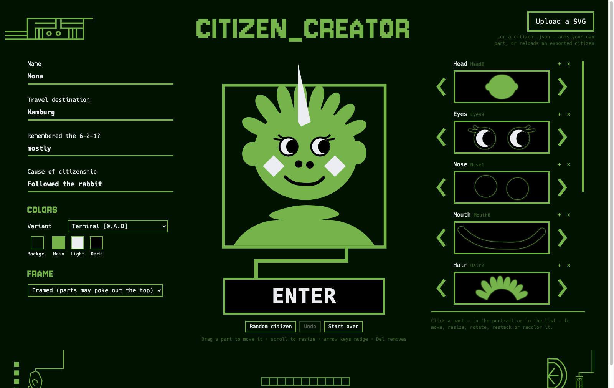

# 40C3 CITIZEN_CREATOR

Build your own model citizen avatar in the style of the
[40C3 "Model Citizens" styleguide](https://events.ccc.de/congress/2026/infos/styleguide/).

**Use it: <https://sebastian-tschen.github.io/40c3-citizen-creator/>**



This is an unofficial community project. It is not made or endorsed by the CCC or
the 40C3 design team; it just uses the parts they published.

## What it does

- Pick head, eyes, nose, mouth, hair, body and deco from the styleguide's citizen
  creator parts, plus the styleguide icons as extras.
- Drag parts to move them, scroll to resize, shift-scroll to rotate; flip, restack
  and recolour each part.
- Colours from the styleguide palette, with presets after its colour variants.
- Upload your own SVG as an additional part.
- Export the avatar as SVG or PNG, a "citizen pass" card as SVG or PNG, and the
  citizen as a JSON file.
- Reload a citizen later from the JSON file, from an exported SVG (it carries the
  same data), or from a link.

Everything runs in the browser. Nothing is uploaded anywhere and nothing is stored.

## Standalone file

[`citizen_creator.html`](citizen_creator.html) is the whole app in one file, with
all parts and fonts embedded. Download it and open it in a browser; it needs no
server and no network.

## Three pages

The tabs at the top switch between the citizen creator, the pattern creator and
[`assets.html`](assets.html), which offers the styleguide's artwork for download:
the logo in every palette color, and icons, boxes, citizens, patterns and creator
parts in colors of your choice, as SVG, PNG or all at once as a zip. Each page is
its own standalone file; the tabs work when the files sit next to each other.

## Pattern creator (draft)

[`pattern_creator.html`](pattern_creator.html) fills a space of any size with the
line-art objects of the styleguide's pattern page. The four pattern strips are cut
into single objects (the table is in `build.py`), packed at random, and every
object can then be moved, swapped, mirrored, rotated, recoloured or removed.
"Seamless" makes a pattern that repeats as a tile. Exports: SVG, PNG and a JSON
file; the JSON and the SVG can be loaded again.

Each object has an area (a mask of 4-unit cells, not necessarily a rectangle) and
connection points (free wire ends with a direction). The fill keeps other objects
out of the area and hangs objects onto open wire ends; Shift while dragging snaps
connection points by hand. Both are edited in the page ("edit shapes & connection
points"); edits stay in the browser until you download the object data, save it as
`src/pattern_tiles.json` and rebuild.

## Citizen file format

```json
{
  "format": "40c3-citizen",
  "version": 1,
  "name": "Mona",
  "colors": { "background": "#001300", "main": "#75b44b", "light": "#ebedf0", "dark": "#000000" },
  "frame": "box",
  "layers": [
    { "part": "Body1" },
    { "part": "Head0" },
    { "part": "Eyes9", "x": 500, "y": 460, "scale": 0.633, "rot": 0, "flip": false }
  ]
}
```

Layers are drawn in order, first at the back. Only `part` is required per layer;
position, scale, rotation and colours fall back to defaults. A layer can also carry
`"colors": { "main": "#…", "light": "#…", "dark": "#…" }` to recolour just that part,
and `"outline": true` (or a colour) to draw a thin outline around it. Part names are the
file names in `Citizen_Creator_Assets/` and `Assets/Icons_Deco/` without `.svg`.

## Building

`citizen_creator.html`, `pattern_creator.html` and `assets.html` are generated. Edit the templates
in `src/` (the citizen template includes the table that places each part) or the
assets, then run:

```
python3 build.py
```

It needs Python 3 and nothing else.

## Licences

- **Code** (`build.py`, `src/`, `index.html`): [CC0 1.0](LICENSE).
- **Artwork** (`Assets/`, `Citizen_Creator_Assets/`): by the 40C3 design team,
  released under CC0 according to the
  [styleguide page](https://events.ccc.de/congress/2026/infos/styleguide/).
  This repo contains only the parts of the styleguide package the app uses; get the
  full package there.
- **Fonts** (`fonts/`, also embedded in `citizen_creator.html`):
  [Hack](https://github.com/source-foundry/Hack) under the MIT and Bitstream Vera
  licences, [Jersey 10](https://github.com/scfried/soft-type-jersey) under the
  SIL Open Font License 1.1. The licence texts are in `fonts/` and inside the app
  under "licences".
